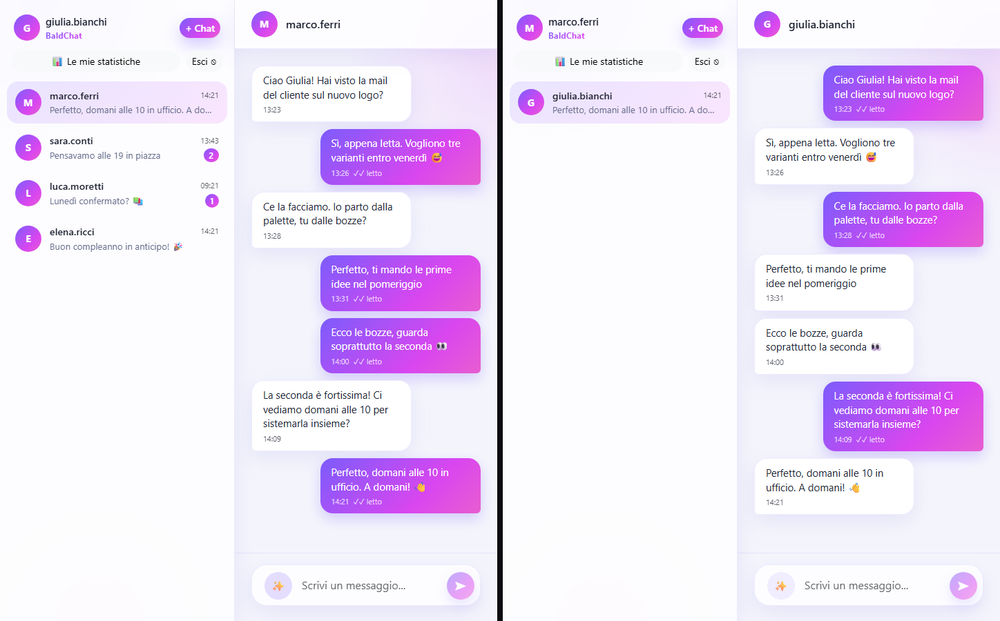
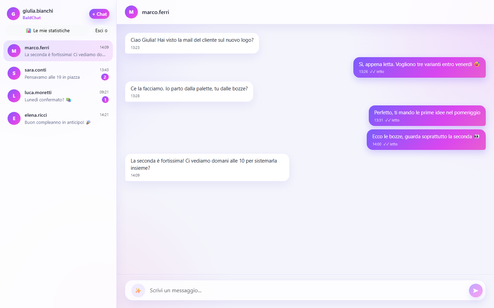
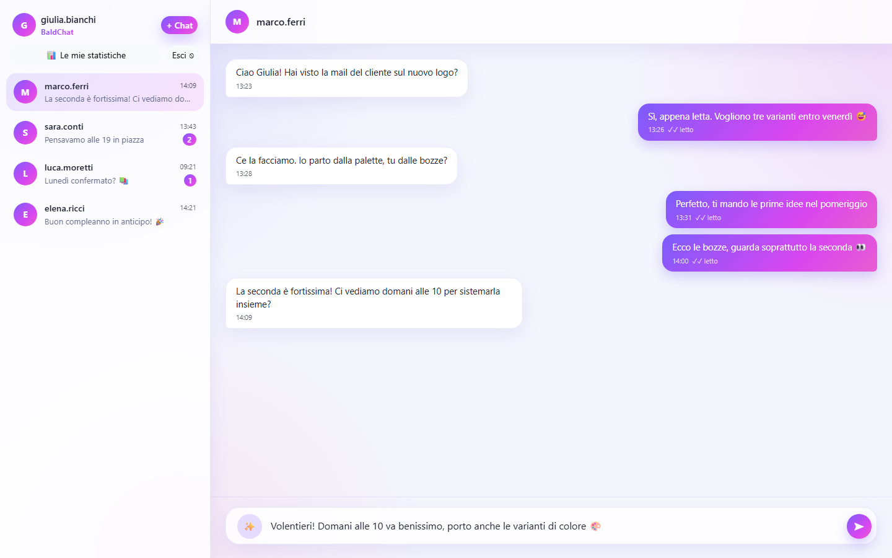
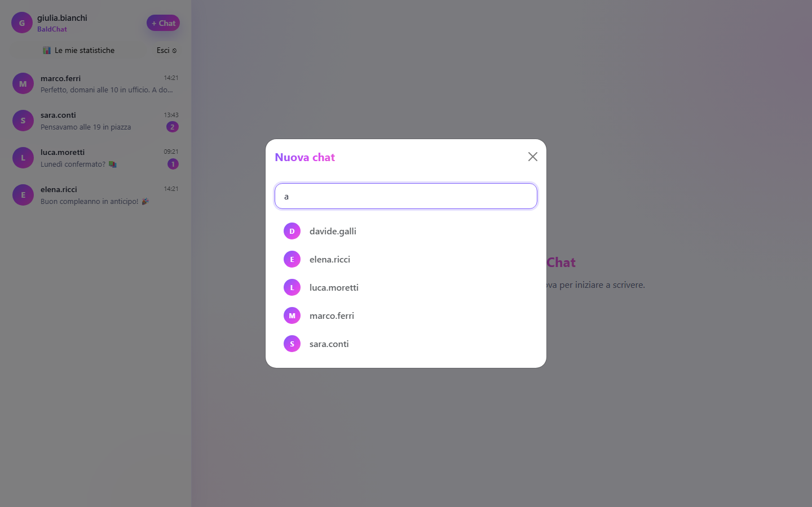
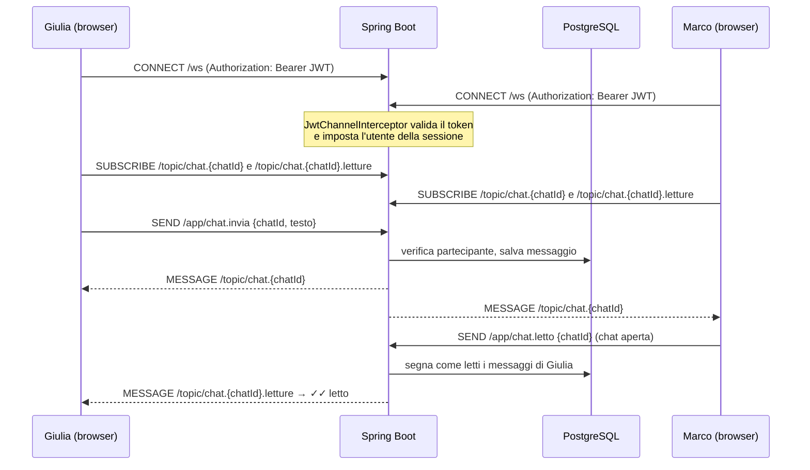

🇬🇧 [English](README.md) · 🇮🇹 Italiano

# BaldChat

Una chat privata in tempo reale con suggerimenti di risposta generati dall'IA.

Gli utenti si registrano, cercano altri utenti e chattano con loro in tempo reale tramite WebSocket, con contatori dei messaggi non letti e conferme di lettura. In ogni conversazione possono chiedere all'IA una risposta, che viene scritta nel campo del messaggio per essere modificata o inviata. Possono anche ricevere via email le statistiche dei propri messaggi.

Realizzato come progetto del corso di [EPICODE Institute of Technology](https://epicode.com): API REST + STOMP in Spring Boot e SPA in React. Interfaccia, codice e percorsi degli endpoint sono in italiano.

<p align="center">
  
</p>

<table>
  <tr>
    <td></td>
    <td></td>
    <td></td>
  </tr>
  <tr>
    <td align="center">Conferme di lettura e badge dei non letti</td>
    <td align="center">Risposta suggerita dall'IA</td>
    <td align="center">Nuova chat: ricerca utenti</td>
  </tr>
</table>

## Funzionalità

**Autenticazione**
- Registrazione con username, email e password (almeno 8 caratteri), con Bean Validation. Username ed email devono essere unici (altrimenti `409`).
- Login JWT stateless; password salvate con hash BCrypt. Username sbagliato e password sbagliata restituiscono lo stesso `401`.
- Il token viaggia nell'header `Authorization` nelle chiamate REST e nel frame STOMP `CONNECT` sul WebSocket.
- Il frontend conserva la sessione in `localStorage` e protegge la pagina della chat con una route guard.

**Chat e messaggi**
- Ricerca degli utenti per username (senza distinzione tra maiuscole e minuscole, escluso sé stessi) e apertura di una chat: se la chat tra i due utenti esiste già viene riusata, altrimenti viene creata. Una chat con sé stessi viene rifiutata.
- L'elenco delle chat mostra l'altro utente, l'ultimo messaggio, l'orario e il numero di messaggi non letti, dalla più recente.
- All'apertura di una chat vengono caricati gli ultimi 50 messaggi (configurabile) in ordine cronologico.
- I messaggi vengono inviati e consegnati tramite WebSocket. Solo i due partecipanti di una chat possono scriverci, segnarla come letta o chiedere un suggerimento: il server lo verifica a ogni operazione.

**Tempo reale**
- Un nuovo messaggio compare subito nella chat aperta di entrambi gli utenti, e l'elenco delle chat aggiorna anteprima, ordine e badge dei non letti.
- Conferme di lettura: i messaggi mostrano `✓ inviato` o `✓✓ letto`. Quando l'altro utente apre la chat, o riceve un messaggio mentre è aperta, le spunte di chi ha scritto si aggiornano in diretta.
- Heartbeat ogni 10 secondi in entrambe le direzioni e riconnessione automatica dopo 4 secondi: una connessione caduta per una scheda in background o un proxy inattivo viene rilevata e ripristinata senza ricaricare la pagina.

**Suggerimenti di risposta con l'IA**
- Un pulsante nel campo del messaggio chiede una risposta al backend. Il backend invia gli ultimi 20 messaggi della chat (configurabile) a un LLM tramite [OpenRouter](https://openrouter.ai) e restituisce il testo suggerito, che viene scritto nel campo del messaggio: non viene inviato niente in automatico.
- Il modello è configurabile (default `openai/gpt-4o-mini`). La chiave API resta sul server.
- Se OpenRouter non è raggiungibile, l'API risponde `502` con un messaggio leggibile, mostrato nell'interfaccia.

**Statistiche via email**
- "Le mie statistiche" conta i messaggi inviati e ricevuti e il numero di chat, e li invia all'utente via email con un template HTML Thymeleaf. Una notifica conferma l'indirizzo di destinazione.

**Errori**
- Un `@RestControllerAdvice` trasforma le eccezioni nello stesso corpo JSON (`timestamp`, `status`, `error`), e il frontend mostra `error` all'utente.

## Come funziona il tempo reale

Il backend usa il message broker STOMP di Spring su un endpoint SockJS. Il browser si connette una volta, con il JWT nel frame `CONNECT`, e si iscrive a due topic per ciascuna delle sue chat.



- **Autenticazione sul socket.** `/ws` è aperto a livello HTTP; `JwtChannelInterceptor` controlla il token sulla `CONNECT` e rifiuta la connessione se manca o non è valido. L'utente viene associato alla sessione STOMP, così i frame `SEND` successivi conoscono il mittente senza ripetere il token.
- **Il mittente lo decide il server.** `/app/chat.invia` riceve solo l'id della chat e il testo; il mittente viene preso dalla sessione, e `MessaggioService` verifica che faccia parte della chat prima di salvare.
- **Prima si salva, poi si trasmette.** Il messaggio viene salvato con `saveAndFlush` prima dell'invio, così il payload contiene già l'id e l'orario di creazione (`@CreationTimestamp`).
- **I contatori dei non letti** sono calcolati dal server al caricamento dell'elenco delle chat, e poi aggiornati dal client con i messaggi che riceve.

## Come funziona l'IA

1. `POST /api/chat/{chatId}/suggerimento` verifica che chi chiama faccia parte della chat.
2. `AiSuggestionService` carica gli ultimi messaggi e li converte nei ruoli della chat: i messaggi di chi chiama diventano `assistant`, quelli dell'altro utente `user`. Un prompt di sistema chiede una risposta breve e naturale in italiano, senza virgolette né commenti.
3. Un `RestClient` di Spring, configurato con l'URL base di OpenRouter e la chiave in `Authorization: Bearer`, chiama `/chat/completions` e restituisce la prima scelta.
4. Il frontend scrive il suggerimento nel campo del messaggio. L'utente decide se modificarlo, inviarlo o scartarlo.

## API

Tutte le rotte tranne registrazione e login richiedono `Authorization: Bearer <token>`.

| Metodo | Percorso | Descrizione |
|---|---|---|
| `POST` | `/api/auth/registrati` | Registrazione, restituisce `{ token, userId, username }` |
| `POST` | `/api/auth/login` | Login, stessa risposta |
| `GET` | `/api/utenti?q=` | Ricerca utenti per username |
| `GET` | `/api/chat` | Chat dell'utente corrente, con ultimo messaggio e numero di non letti |
| `POST` | `/api/chat/apri` | Apre o crea la chat con `{ altroUtenteId }`, con gli ultimi messaggi |
| `POST` | `/api/chat/{chatId}/suggerimento` | Risposta suggerita dall'IA: `{ suggerimento }` |
| `POST` | `/api/utenti/me/statistiche` | Calcola le statistiche e le invia via email |

| STOMP | Destinazione | Payload |
|---|---|---|
| Endpoint | `/ws` (SockJS) | Header `Authorization: Bearer <token>` sulla `CONNECT` |
| `SEND` | `/app/chat.invia` | `{ chatId, testo }` |
| `SEND` | `/app/chat.letto` | `{ chatId }` |
| `SUBSCRIBE` | `/topic/chat.{chatId}` | Nuovi messaggi |
| `SUBSCRIBE` | `/topic/chat.{chatId}.letture` | Eventi di lettura `{ chatId, lettoreId, momento }` |

## Stack tecnologico

| Area | Tecnologia | Versione |
|---|---|---|
| Backend | Java | 25 |
| | Spring Boot (Web MVC, WebSocket, Security, Data JPA, Validation, Mail, Thymeleaf) | 4.1.1 |
| | jjwt (`jjwt-api`, `jjwt-impl`, `jjwt-jackson`) | 0.13.0 |
| | PostgreSQL | 16 (usato in sviluppo) |
| | Lombok | da Spring Boot |
| | Maven (wrapper) | 3.9.16 |
| Frontend | React | 19.2 |
| | TypeScript | 6.0 |
| | Vite | 8.2 |
| | React Router | 7.18 |
| | Bootstrap + React-Bootstrap | 5.3 / 2.10 |
| | @stomp/stompjs + sockjs-client | 7.3 / 1.6 |
| Servizi esterni | OpenRouter (API per LLM) | |
| | Server SMTP (email delle statistiche) | |

## Architettura

```
BE/   API REST + STOMP in Spring Boot
  controller/   endpoint REST: autenticazione, chat, ricerca utenti, statistiche
  websocket/    WebSocketConfig, JwtChannelInterceptor, ChatWebSocketController
  service/      autenticazione, chat, messaggi, suggerimenti IA, statistiche, email
  repository/   repository Spring Data JPA
  entity/       User, Chat, Messaggio
  dto/          record di richiesta e risposta, richiesta e risposta di OpenRouter
  security/     filtro e servizio JWT, regole di sicurezza, CORS
  config/       RestClient per OpenRouter
  exception/    eccezioni personalizzate e GlobalExceptionHandler
  resources/templates/email/   template Thymeleaf dell'email delle statistiche

FE/   SPA React + TypeScript
  src/api/        client fetch con JWT e funzioni API tipizzate
  src/context/    AuthContext e SocketContext (client STOMP)
  src/pages/      login, registrazione, chat
  src/components/ barra laterale, finestra della chat, fumetto del messaggio, finestra nuova chat, route guard
```

Le note di progettazione (entità, flussi, controller) sono in [PROGETTAZIONE.md](PROGETTAZIONE.md).

## Avvio in locale

### Prerequisiti

- JDK 25
- Node.js 20.19 o successivo
- PostgreSQL
- Una chiave API di [OpenRouter](https://openrouter.ai), per i suggerimenti dell'IA
- Facoltativo: un account SMTP, per l'email delle statistiche

### 1. Clona

```bash
git clone https://github.com/TheRedKardinal/realtime-chat-ai.git
cd realtime-chat-ai
```

### 2. Database

```bash
createdb -U postgres messaggistica_database
```

L'URL del database è `jdbc:postgresql://localhost:5432/messaggistica_database`. Le tabelle vengono create al primo avvio.

### 3. Backend

```bash
cd BE
cp .env.example .env     # poi compila i valori (vedi sotto)
./mvnw spring-boot:run   # Windows: mvnw.cmd spring-boot:run
```

L'API parte su `http://localhost:8080`.

### 4. Frontend

```bash
cd FE
cp .env.example .env
npm install
npm run dev
```

L'app si apre su `http://localhost:5173`. Registra due utenti, in due browser diversi o in una finestra privata, per chattare tra loro.

Su macOS e Linux, `./start.sh` nella cartella del progetto avvia insieme backend e frontend.

## Variabili d'ambiente

Modelli: `BE/.env.example` e `FE/.env.example`. Il backend legge `BE/.env` tramite `spring.config.import`; funzionano anche le variabili d'ambiente reali. I file `.env` sono esclusi da git.

**Backend (`BE/.env`)**

| Variabile | Scopo | Default |
|---|---|---|
| `OPENROUTER_API_KEY` | Chiave API di OpenRouter | nessuno, obbligatoria |
| `OPENROUTER_MODEL` | Modello usato per i suggerimenti | `openai/gpt-4o-mini` |
| `JWT_SECRET` | Chiave per firmare i JWT, almeno 32 caratteri | nessuno, obbligatoria |
| `JWT_EXPIRATION_MS` | Durata del token in millisecondi | `86400000` (24 ore) |
| `DB_USERNAME`, `DB_PASSWORD` | Credenziali PostgreSQL | `postgres` / `postgres` |
| `MAIL_HOST`, `MAIL_PORT` | Server SMTP | `smtp.gmail.com` / `587` |
| `MAIL_USERNAME`, `MAIL_PASSWORD` | Credenziali SMTP | vuote |
| `CHAT_MESSAGGI_DEFAULT_LIMIT` | Messaggi caricati all'apertura di una chat | `50` |
| `AI_CONTESTO_MESSAGGI_LIMIT` | Messaggi inviati all'IA come contesto | `20` |

Senza credenziali SMTP l'app funziona, ma "Le mie statistiche" risponde `502` con un messaggio di errore.

**Frontend (`FE/.env`)**

| Variabile | Scopo | Default |
|---|---|---|
| `VITE_API_BASE_URL` | URL base del backend, per REST e WebSocket | `http://localhost:8080` |

## Test

```bash
cd BE
./mvnw test
```

C'è un test di base (`DemoApplicationTests`) che verifica l'avvio del contesto Spring. Richiede PostgreSQL attivo e `BE/.env` con `JWT_SECRET` e `OPENROUTER_API_KEY` impostate; non viene fatta nessuna chiamata a OpenRouter.

## Limiti noti

- **Le iscrizioni STOMP non sono autorizzate.** Il token viene controllato solo sulla `CONNECT`, quindi un utente loggato che conosce l'id della chat di altri potrebbe iscriversi al suo topic. Soluzione: in `JwtChannelInterceptor`, sulla `SUBSCRIBE`, verificare che l'utente faccia parte della chat della destinazione.
- **L'endpoint WebSocket accetta qualsiasi origine.** `/ws` usa `setAllowedOriginPatterns("*")`, mentre il CORS REST è limitato a `http://localhost:*`. Soluzione: consentire solo l'origine del frontend, letta da una variabile d'ambiente.

## Autore

Claudio Giasi: [GitHub](https://github.com/TheRedKardinal) · [LinkedIn](https://www.linkedin.com/in/claudio-giasi/)

---

Il progetto non è pubblicato online: per provarlo, avvialo in locale seguendo [Avvio in locale](#avvio-in-locale).
