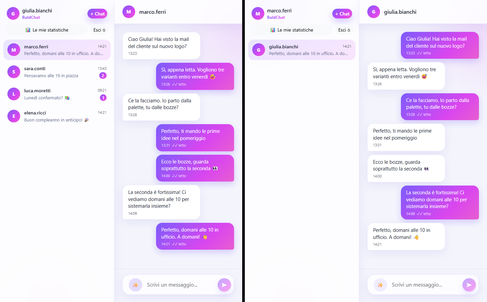
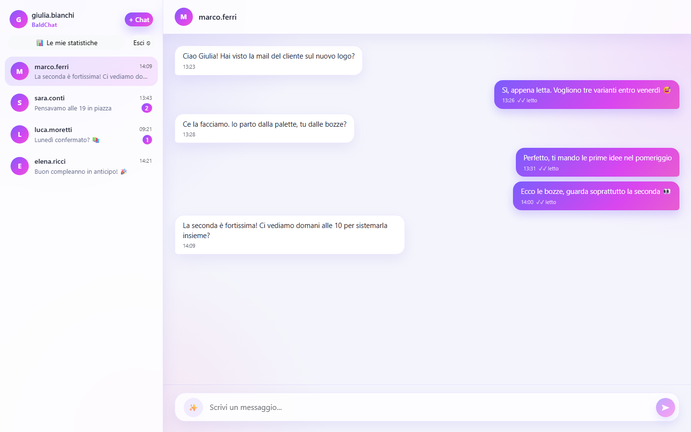
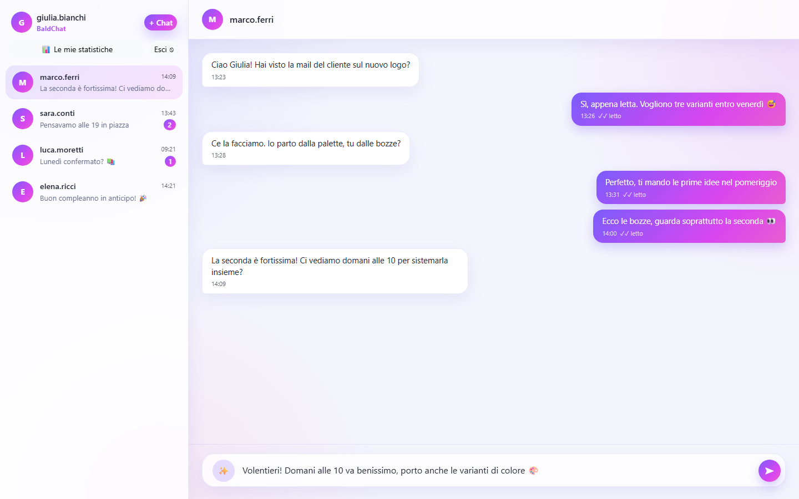
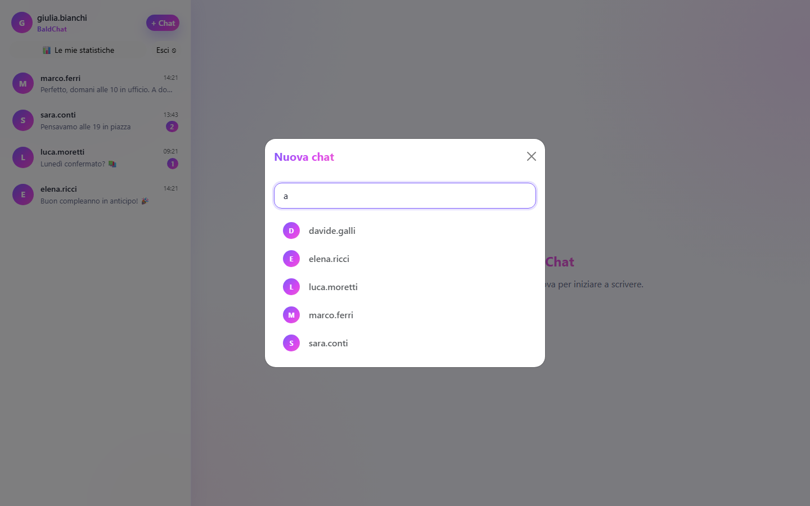
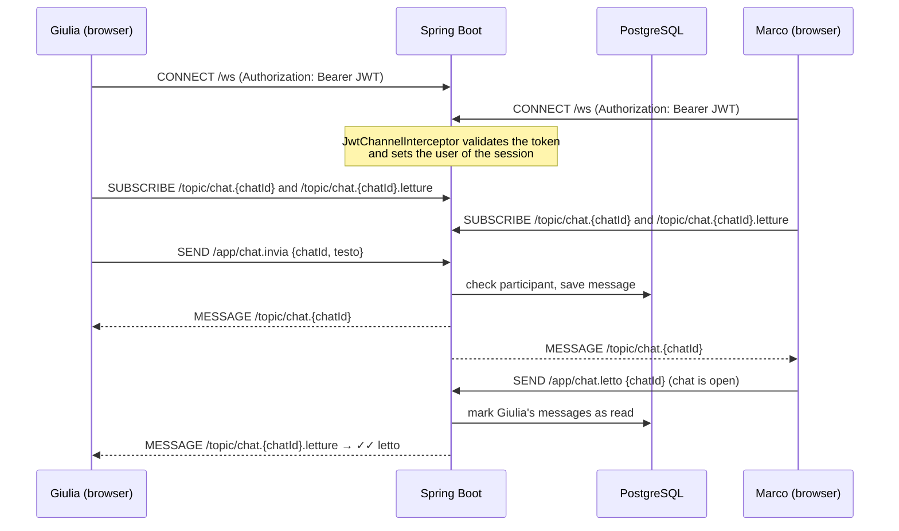

🇬🇧 English · 🇮🇹 [Italiano](README.it.md)

# BaldChat

A real-time one-to-one chat with reply suggestions generated by AI.

Users sign up, search for other users and chat with them in real time over WebSocket, with unread counters and read receipts. In any conversation they can ask the AI for a reply, which is written into the message box for them to edit or send. They can also have their messaging statistics sent to them by email.

Built as a course project at [EPICODE Institute of Technology](https://epicode.com): Spring Boot REST + STOMP API and React SPA. The UI, the codebase and the endpoint paths are in Italian (`utenti` = users, `messaggi` = messages, `suggerimento` = suggestion, `statistiche` = statistics).

<p align="center">
  
</p>

<table>
  <tr>
    <td></td>
    <td></td>
    <td></td>
  </tr>
  <tr>
    <td align="center">Read receipts and unread badges</td>
    <td align="center">AI-suggested reply</td>
    <td align="center">New chat: user search</td>
  </tr>
</table>

## Features

**Authentication**
- Sign-up with username, email and password (at least 8 characters), with Bean Validation. Username and email must be unique (`409` otherwise).
- Stateless JWT login; passwords are hashed with BCrypt. Wrong username and wrong password return the same `401`.
- The token is sent in the `Authorization` header on REST calls and in the STOMP `CONNECT` frame on the WebSocket.
- The frontend keeps the session in `localStorage` and protects the chat page with a route guard.

**Chats and messages**
- Search users by username (case-insensitive, excluding yourself) and open a chat: if a chat between the two users already exists it is reused, otherwise it is created. A chat with yourself is rejected.
- The chat list shows the other user, the last message, its time and the number of unread messages, newest first.
- Opening a chat loads the latest 50 messages (configurable) in chronological order.
- Messages are sent and delivered over WebSocket. Only the two participants of a chat can send messages in it, mark it as read or ask for a suggestion: the server checks it on every operation.

**Real time**
- A new message appears immediately in the open chat of both users, and the chat list updates its preview, its order and the unread badge.
- Read receipts: messages show `✓ inviato` (sent) or `✓✓ letto` (read). When the other user opens the chat, or receives a message while it is open, the sender's ticks update live.
- Heartbeats every 10 seconds in both directions and automatic reconnection after 4 seconds, so a connection dropped by a background tab or an idle proxy is detected and restored without reloading the page.

**AI reply suggestions**
- A button in the message box asks the backend for a reply. The backend sends the latest 20 messages of the chat (configurable) to an LLM through [OpenRouter](https://openrouter.ai) and returns the suggested text, which is written into the message box: nothing is sent automatically.
- The model is configurable (default `openai/gpt-4o-mini`). The API key stays on the server.
- If OpenRouter cannot be reached, the API answers `502` with a readable message, shown in the UI.

**Statistics by email**
- "Le mie statistiche" (my statistics) counts the messages sent and received and the number of chats, and emails them to the user with an HTML Thymeleaf template. A notification confirms the recipient address.

**Errors**
- A `@RestControllerAdvice` turns exceptions into the same JSON body (`timestamp`, `status`, `error`), and the frontend shows `error` to the user.

## How the real-time part works

The backend uses Spring's STOMP message broker over a SockJS endpoint. The browser connects once, with the JWT in the `CONNECT` frame, and subscribes to two topics for each of its chats.



- **Authentication on the socket.** `/ws` is open at the HTTP level; `JwtChannelInterceptor` checks the token on `CONNECT` and rejects the connection if it is missing or invalid. The user is attached to the STOMP session, so `SEND` frames that follow know the sender without carrying the token again.
- **The server decides who is sending.** `/app/chat.invia` takes only the chat id and the text; the sender is taken from the session, and `MessaggioService` checks that the sender belongs to the chat before saving.
- **Save, then broadcast.** The message is saved with `saveAndFlush` before it is broadcast, so the payload already carries the id and the creation time (`@CreationTimestamp`).
- **Unread counters** are calculated by the server when the chat list is loaded, and then kept up to date by the client from the messages it receives.

## How the AI part works

1. `POST /api/chat/{chatId}/suggerimento` checks that the caller belongs to the chat.
2. `AiSuggestionService` loads the latest messages and maps them to chat roles: the caller's messages become `assistant`, the other user's become `user`. A system prompt asks for a short, natural reply in Italian, with no quotes or comments.
3. A Spring `RestClient`, configured with the OpenRouter base URL and the `Authorization: Bearer` key, calls `/chat/completions` and returns the first choice.
4. The frontend writes the suggestion into the message box. The user decides whether to edit it, send it or discard it.

## API

All routes except register and login require `Authorization: Bearer <token>`.

| Method | Path | Description |
|---|---|---|
| `POST` | `/api/auth/registrati` | Sign up, returns `{ token, userId, username }` |
| `POST` | `/api/auth/login` | Log in, same response |
| `GET` | `/api/utenti?q=` | Search users by username |
| `GET` | `/api/chat` | Chats of the current user, with last message and unread count |
| `POST` | `/api/chat/apri` | Open or create the chat with `{ altroUtenteId }`, with the latest messages |
| `POST` | `/api/chat/{chatId}/suggerimento` | AI-suggested reply: `{ suggerimento }` |
| `POST` | `/api/utenti/me/statistiche` | Calculate the statistics and send them by email |

| STOMP | Destination | Payload |
|---|---|---|
| Endpoint | `/ws` (SockJS) | `Authorization: Bearer <token>` header on `CONNECT` |
| `SEND` | `/app/chat.invia` | `{ chatId, testo }` |
| `SEND` | `/app/chat.letto` | `{ chatId }` |
| `SUBSCRIBE` | `/topic/chat.{chatId}` | New messages |
| `SUBSCRIBE` | `/topic/chat.{chatId}.letture` | Read events `{ chatId, lettoreId, momento }` |

## Tech stack

| Area | Technology | Version |
|---|---|---|
| Backend | Java | 25 |
| | Spring Boot (Web MVC, WebSocket, Security, Data JPA, Validation, Mail, Thymeleaf) | 4.1.1 |
| | jjwt (`jjwt-api`, `jjwt-impl`, `jjwt-jackson`) | 0.13.0 |
| | PostgreSQL | 16 (used in development) |
| | Lombok | from Spring Boot |
| | Maven (wrapper) | 3.9.16 |
| Frontend | React | 19.2 |
| | TypeScript | 6.0 |
| | Vite | 8.2 |
| | React Router | 7.18 |
| | Bootstrap + React-Bootstrap | 5.3 / 2.10 |
| | @stomp/stompjs + sockjs-client | 7.3 / 1.6 |
| External services | OpenRouter (LLM API) | |
| | SMTP server (statistics email) | |

## Architecture

```
BE/   Spring Boot REST + STOMP API
  controller/   REST endpoints: auth, chats, user search, statistics
  websocket/    WebSocketConfig, JwtChannelInterceptor, ChatWebSocketController
  service/      auth, chats, messages, AI suggestions, statistics, email
  repository/   Spring Data JPA repositories
  entity/       User, Chat, Messaggio (message)
  dto/          request and response records, OpenRouter request and response
  security/     JWT filter and service, security rules, CORS
  config/       RestClient for OpenRouter
  exception/    custom exceptions and GlobalExceptionHandler
  resources/templates/email/   Thymeleaf template of the statistics email

FE/   React + TypeScript SPA
  src/api/        fetch client with JWT and typed API functions
  src/context/    AuthContext and SocketContext (STOMP client)
  src/pages/      login, sign-up, chat
  src/components/ sidebar, chat window, message bubble, new chat dialog, route guard
```

Design notes (entities, flows, controllers) are in [PROGETTAZIONE.md](PROGETTAZIONE.md), in Italian.

## Getting started

### Prerequisites

- JDK 25
- Node.js 20.19 or later
- PostgreSQL
- An [OpenRouter](https://openrouter.ai) API key, for the AI suggestions
- Optional: an SMTP account, for the statistics email

### 1. Clone

```bash
git clone https://github.com/TheRedKardinal/realtime-chat-ai.git
cd realtime-chat-ai
```

### 2. Database

```bash
createdb -U postgres messaggistica_database
```

The database URL is `jdbc:postgresql://localhost:5432/messaggistica_database`. The tables are created on the first startup.

### 3. Backend

```bash
cd BE
cp .env.example .env     # then fill in the values (see below)
./mvnw spring-boot:run   # Windows: mvnw.cmd spring-boot:run
```

The API starts on `http://localhost:8080`.

### 4. Frontend

```bash
cd FE
cp .env.example .env
npm install
npm run dev
```

The app opens on `http://localhost:5173`. Sign up two users, in two different browsers or in a private window, to chat between them.

On macOS and Linux, `./start.sh` in the project folder starts the backend and the frontend together.

## Environment variables

Templates: `BE/.env.example` and `FE/.env.example`. The backend reads `BE/.env` through `spring.config.import`; real environment variables work too. The `.env` files are git-ignored.

**Backend (`BE/.env`)**

| Variable | Purpose | Default |
|---|---|---|
| `OPENROUTER_API_KEY` | OpenRouter API key | none, required |
| `OPENROUTER_MODEL` | Model used for the suggestions | `openai/gpt-4o-mini` |
| `JWT_SECRET` | Key used to sign JWTs, at least 32 characters | none, required |
| `JWT_EXPIRATION_MS` | Token lifetime in milliseconds | `86400000` (24 hours) |
| `DB_USERNAME`, `DB_PASSWORD` | PostgreSQL credentials | `postgres` / `postgres` |
| `MAIL_HOST`, `MAIL_PORT` | SMTP server | `smtp.gmail.com` / `587` |
| `MAIL_USERNAME`, `MAIL_PASSWORD` | SMTP credentials | empty |
| `CHAT_MESSAGGI_DEFAULT_LIMIT` | Messages loaded when a chat is opened | `50` |
| `AI_CONTESTO_MESSAGGI_LIMIT` | Messages sent to the AI as context | `20` |

Without SMTP credentials the app works, but "Le mie statistiche" answers `502` with an error message.

**Frontend (`FE/.env`)**

| Variable | Purpose | Default |
|---|---|---|
| `VITE_API_BASE_URL` | Base URL of the backend, for REST and WebSocket | `http://localhost:8080` |

## Running tests

```bash
cd BE
./mvnw test
```

There is one smoke test (`DemoApplicationTests`) that checks that the Spring context starts. It needs PostgreSQL running and `BE/.env` with `JWT_SECRET` and `OPENROUTER_API_KEY` set; no call is made to OpenRouter.

## Known limitations

- **STOMP subscriptions are not authorized.** The token is checked on `CONNECT` only, so a logged-in user who knows the id of someone else's chat could subscribe to its topic. Fix: check in `JwtChannelInterceptor`, on `SUBSCRIBE`, that the user belongs to the chat in the destination.
- **The WebSocket endpoint accepts any origin.** `/ws` uses `setAllowedOriginPatterns("*")`, while REST CORS is limited to `http://localhost:*`. Fix: allow only the frontend origin, read from an environment variable.

## Author

Claudio Giasi: [GitHub](https://github.com/TheRedKardinal) · [LinkedIn](https://www.linkedin.com/in/claudio-giasi/)

---

This project is not deployed online: to try it, run it locally by following [Getting started](#getting-started).
